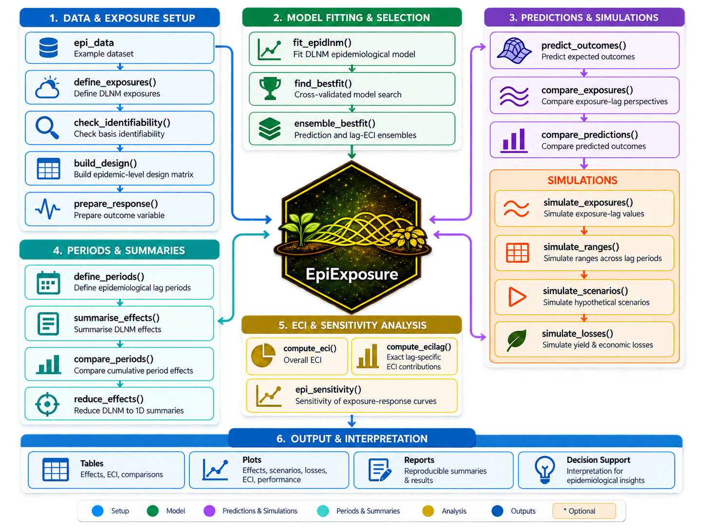
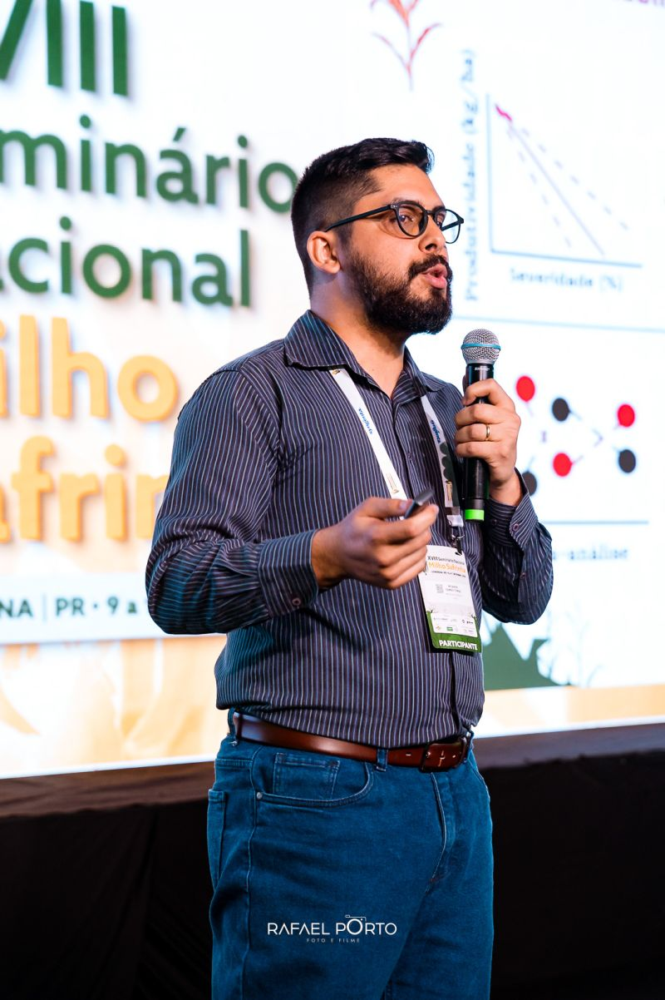

Here, we provide the code used to introduces the EpiExposure, an R package for modeling and interpreting epidemiological exposure–lag–response relationships, simulating exposure profiles, and predicting plant disease outcomes from environmental drivers.
 
A preprint version of this work has been available at [here]().

------------------------------------------------------------------------

## Why is this package important?

<div style="text-align: justify;">

In plant disease epidemiology, environmental effects are often non-linear, cumulative, and time-dependent. Traditional approaches commonly summarize environmental conditions within predefined temporal windows, which may obscure delayed or continuously varying associations. EpiExposure provides a unified DLNM-based workflow for preserving exposure profiles, modeling lagged associations, and translating fitted models into epidemiologically interpretable summaries, simulations, and predictions.

</div>

------------------------------------------------------------------------

{fig-align="center" width="100%"}

------------------------------------------------------------------------

## Who am I?

::: {style="display:flex; align-items:center; gap:20px; margin-top:20px;"}
```{=html}

```

<p style="max-width:600px;">

I'm Ricardo G. Tomáz, a Brazilian PhD Student in Plant Pathology (UFV) and I am doing my PhD Sandwich Program at LSU (EUA). I have strong expertise in crop disease epidemiology, predictive modeling, and yield-loss simulation in crops such as soybean, wheat, and maize. In addition, I have worked with remote sensing to identify and quantify important disease in rice.

</p>
:::

------------------------------------------------------------------------

## Let me know something

📧 **rtomaz\@agcenter.lsu.br**